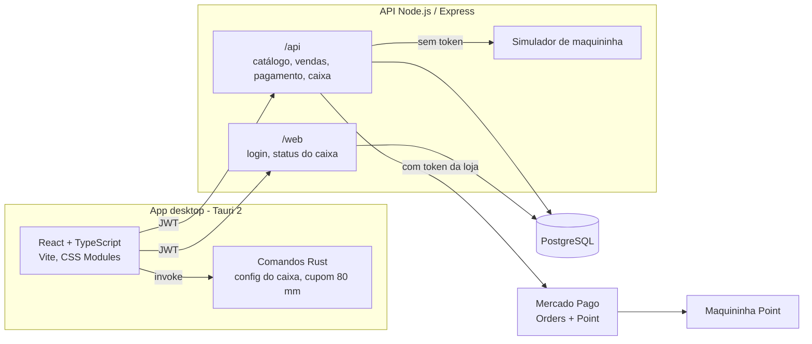

# Balcão PDV: frente de caixa desktop com Tauri

Aplicativo de **ponto de venda (PDV)** para balcão de padarias, cafés e pequenos varejos. Ele roda como **app desktop** (Tauri 2: Rust + WebView) e foi feito para ser operado quase só com **teclado e leitor de código de barras**. O operador abre o caixa, passa os produtos (inclusive os vendidos por peso), divide o pagamento entre dinheiro, PIX e cartão, e as cobranças eletrônicas vão direto para a **maquininha Mercado Pago Point** ligada ao caixa. Sangria e fechamento com resumo do dia ficam a um atalho de distância.

Uma API Node.js/Express pequena faz a ponte com o PostgreSQL (catálogo, estoque, vendas, movimentos de caixa) e com a API do Mercado Pago.

> **Sobre esta versão:** versão anonimizada de um sistema que construí e que roda em produção para uma empresa; nomes, marca, domínios, conteúdo proprietário e dados foram substituídos por fictícios.

**English summary:** Desktop point-of-sale app (Tauri 2 + React 18 + TypeScript + Vite) built for keyboard and barcode-scanner operation, with a Node.js/Express + PostgreSQL API. Features barcode lookup with quantity multiplier (`15*`), weighed products, split payments (cash with change, PIX, debit, credit installments) sent serially to a Mercado Pago Point card terminal with status polling, cash-drawer open/bleed/close with end-of-day totals, daily promotions with live countdown, and receipt printing on the terminal. JWT sessions with tenant scoping, bcrypt with transparent migration of legacy MD5 hashes. Without a Mercado Pago token, a built-in terminal simulator approves charges so the whole flow runs locally.

---

## Sumário

- [O que o app faz](#o-que-o-app-faz)
- [Arquitetura](#arquitetura)
- [Stack](#stack)
- [Rodar localmente](#rodar-localmente)
- [Contas de demonstração](#contas-de-demonstração)
- [Roteiro para testar](#roteiro-para-testar)
- [Integrações](#integrações)
- [Segurança](#segurança)
- [Decisões técnicas](#decisões-técnicas)
- [Estrutura do repositório](#estrutura-do-repositório)
- [Variáveis de ambiente](#variáveis-de-ambiente)

---

## O que o app faz

### Frente de caixa

| Recurso | Como funciona |
|---|---|
| **Leitor de código de barras** | O campo de busca mantém o foco o tempo todo. A leitura termina com Enter e o produto entra no cupom. Digitar o nome mostra a lista filtrada enquanto se digita. |
| **Multiplicador** | `15*` antes da leitura adiciona 15 unidades de uma vez, com aviso visual e opção de cancelar. |
| **Produtos por peso** | Produtos `PESO` (preço por kg) abrem o modal de pesagem antes de entrar no cupom. |
| **Cupom** | Total em tempo real, remoção de item com escolha da quantidade e cancelamento da venda inteira. |
| **Pagamento dividido** | Vários pagamentos na mesma venda: PIX, débito, crédito (com parcelas) e espécie, com cálculo de troco. |
| **Maquininha** | Cada pagamento eletrônico vira uma cobrança na maquininha do caixa, uma de cada vez. O app consulta o status a cada 2 s. Da segunda cobrança em diante, uma "aprovação" que chega rápido demais (menos de 5 s) pausa o fluxo e pede confirmação ao operador (ou uma nova tentativa). |
| **Última venda** | Card com os itens e pagamentos da venda anterior e botão de reimpressão do comprovante. |
| **Consulta de preço** | Modal para conferir o preço de um produto sem mexer no cupom. |
| **Promoções do dia** | Barra lateral com as ofertas válidas agora, contagem regressiva até o fim de cada uma (destaque na última hora), paginação e atualização automática a cada 15 s. |

### Gestão de caixa

- **Abertura** com valor inicial da gaveta (`Ctrl+F3`). Com o caixa fechado, a tela de venda fica bloqueada.
- **Sangria** com valor e motivo (`Ctrl+F4`).
- **Fechamento** (`Ctrl+F6`) com o resumo calculado na API: valor de abertura, total em espécie esperado na gaveta (abertura + vendas em dinheiro − sangrias) e total geral.

### Atalhos

| Tecla | Ação |
|---|---|
| `Enter` | Confirma a leitura / o modal aberto |
| `Esc` | Fecha o modal aberto |
| `Ctrl+1` | Abre o pagamento |
| `Ctrl+2` | Cancela a venda |
| `1` a `4` (no pagamento) | PIX, débito, crédito, espécie |
| `Ctrl+F3` / `Ctrl+F4` / `Ctrl+F6` | Abertura / sangria / fechamento |
| `F5`, `F11` | Bloqueados, para o operador não recarregar a tela no meio de uma venda |

### App desktop (Tauri)

- Cada computador de caixa tem um `Documentos/pdv/config.json` com o número do caixa e da loja. O front lê esse arquivo por um comando Rust (`ler_config`). Modelo em [`docs/config.example.json`](docs/config.example.json).
- O lado Rust também tem comandos para gerar um cupom não fiscal em HTML no formato 80 mm e mandá-lo para a impressora local (`imprimir_nota`, `imprimir_direto`, `visualizar_cupom`). A interface atual imprime o comprovante na própria maquininha. Esses comandos ficam disponíveis para lojas sem maquininha com impressora.

---

## Arquitetura



**Fluxo de uma venda**

1. O operador entra; a API devolve um token com o usuário e a loja dele.
2. Leitura dos produtos e escolha dos pagamentos.
3. `POST /api/gerar_venda` grava a venda e os itens e baixa o estoque (primeiro da vitrine, depois do depósito).
4. Para cada pagamento eletrônico, `POST /api/continuar_pagamento` cria uma ordem na maquininha e guarda o id dela na venda.
5. O app consulta `GET /api/valida_pagamento/:id` até a venda ficar `processed` (ou `canceled`). Com mais de uma cobrança, o operador inicia a próxima quando a anterior termina.
6. O comprovante é impresso na maquininha (`POST /api/imprimir`).

---

## Stack

**Desktop / front:** Tauri 2 (Rust), React 18, TypeScript 5.9, Vite 5, React Router 6, CSS Modules, React Feather.

**API:** Node.js 22, Express 4, PostgreSQL (`pg`), jsonwebtoken, bcryptjs, `fetch` nativo para o Mercado Pago.

**Infra local:** `docker-compose` com PostgreSQL, API e a interface servida como site (Nginx). Em produção a API roda numa VPS e o app é instalado em cada caixa. Os scripts de deploy foram retirados deste repositório.

---

## Rodar localmente

### Opção 1: Docker (só a interface no navegador)

Pré-requisito: Docker Desktop.

```bash
git clone https://github.com/vitormouramaker/balcao-pdv-desktop.git
cd balcao-pdv-desktop
docker compose up --build
```

- Interface: http://localhost:1420
- API: http://localhost:4444/health

Na subida, o compose cria o banco, as tabelas e os [dados de demonstração](#contas-de-demonstração). A maquininha fica no modo simulado.

### Opção 2: Sem Docker

Pré-requisitos: Node.js 20+ e PostgreSQL 14+ rodando localmente. Para o app desktop, também o [ambiente do Tauri](https://tauri.app/start/prerequisites/) (Rust via `rustup` e, no Windows, o WebView2).

```bash
# 1. API
cd backend
cp .env.example .env          # ajuste DB_USER / DB_PASSWORD / DB_PORT se precisar
npm install
npm run db:init               # cria o banco balcao_pdv e as tabelas
npm run seed:demo             # loja, caixas, operadores e catálogo fictícios
npm run dev                   # http://localhost:4444

# 2. App (outro terminal, na raiz)
npm install
npm run tauri dev             # app desktop (compila o Rust na primeira vez)
# ou, só a interface no navegador:
npm run dev                   # http://localhost:1420
```

No navegador não existe o `config.json` do caixa; o front usa o caixa e a loja de `VITE_DEFAULT_CAIXA` / `VITE_DEFAULT_FILIAL` (padrão 1 e 1). No app desktop, crie `Documentos/pdv/config.json` a partir de [`docs/config.example.json`](docs/config.example.json).

### Sem Mercado Pago, tudo funciona

Sem o token da loja (`empresa.token_api`) ou sem o terminal do caixa (`caixa.terminal_id`), a API usa um **simulador de maquininha**: a cobrança recebe um id `sim_...` e é aprovada depois de `MOCK_PAYMENT_DELAY_MS` (6 s por padrão). O comprovante que iria para a maquininha aparece no console da API.

---

## Contas de demonstração

Criadas por `npm run seed:demo` (ou automaticamente no Docker). Senha de todas: **`Demo@123`**. As contas existem só no seu banco local, e o seed não roda com `NODE_ENV=production`.

| Perfil | Usuário | Observação |
|---|---|---|
| Frente de caixa | `operador@demo.pdv.test` | |
| Master | `gerente@demo.pdv.test` | |
| Frente de caixa | `legado@demo.pdv.test` | Senha gravada com o hash MD5 antigo; no primeiro login vira bcrypt |

A loja fictícia "Padaria Modelo" tem a loja 1, os caixas 1 e 2, 16 produtos (5 por peso), estoque e quatro promoções. Uma delas termina 45 minutos depois do seed, para mostrar a contagem regressiva em destaque.

## Roteiro para testar

1. Entre como **operador**. A tela de venda aparece bloqueada: abra o caixa com `Ctrl+F3` e um valor inicial.
2. Leia (digite e tecle Enter) `7890000000017` (café). Depois digite `3*` e leia `7890000000062` (croissant, em promoção).
3. Leia `2001` (pão francês, por peso) e informe o peso.
4. `Ctrl+1` para pagar: lance R$ 10,00 no crédito (`3`) em 2 parcelas e o restante em espécie (`4`), informando um valor maior para ver o troco. Confirme e acompanhe a cobrança simulada sendo aprovada.
5. Na última venda, reimprima o comprovante e veja o texto no console da API.
6. Faça uma sangria (`Ctrl+F4`) e feche o caixa (`Ctrl+F6`) para ver o resumo.
7. Saia e entre como **legado**: o login funciona e a senha passa a ser bcrypt no banco.

---

## Integrações

### Mercado Pago Point (maquininha)

- Cobrança pela **API de Orders** (`POST /v1/orders`, `type: point`), com `X-Idempotency-Key`, referência externa da venda, expiração de 16 minutos e método padrão (PIX/QR, débito ou crédito com parcelas).
- Impressão do comprovante não fiscal na própria maquininha (`POST /terminals/v1/actions`, `type: print`), com layout em tags da impressora e QR code de atendimento opcional (`RECEIPT_WHATSAPP`).
- Cada loja tem o seu access token e cada caixa o seu terminal, então várias lojas usam a mesma API.
- `MERCADO_PAGO_MODE=auto|mock|real` escolhe entre a API real e o simulador.
- Em produção, o status da venda (`processed`/`canceled`) é atualizado a partir do retorno do Mercado Pago pelo sistema de gestão da loja, que divide este banco. Esse serviço não faz parte deste repositório; aqui o simulador faz esse papel.

---

## Segurança

- **Sessão com JWT.** O login devolve um token assinado com o usuário e a loja. Todas as rotas `/api` e a de status do caixa exigem o token, e a API **sobrescreve** `empresa_id`, `user_id` e `usuario_id` que vierem do front com os do token. Um operador não lê nem altera dados de outra loja. Cancelar e consultar cobranças também é filtrado pela loja.
- **Senhas com bcrypt.** Hashes MD5 antigos ainda entram (comparação em tempo constante) e são regravados em bcrypt no mesmo login.
- O token fica só em memória no app. O "Lembrar-me" guarda apenas o usuário, nunca a senha.
- CORS com lista de origens (Vite em dev e as origens do Tauri). `x-powered-by` desligado. Erros voltam com mensagem genérica.
- Credenciais de banco e segredo do JWT vêm do ambiente. A API não sobe sem um `JWT_SECRET` de pelo menos 32 caracteres.
- O cupom HTML gerado no Rust escapa os nomes dos produtos.

---

## Decisões técnicas

- **Teclado primeiro.** O foco volta sozinho ao campo de leitura quando um modal fecha. Todo modal confirma com Enter e fecha com Esc, e os métodos de pagamento têm teclas numéricas. Um leitor de código de barras é só um "teclado que digita rápido e tecla Enter", então o mesmo fluxo atende os dois.
- **Cobranças em série com conferência.** Com pagamento dividido, cada parte eletrônica é uma ordem separada na maquininha. A venda guarda o id da cobrança atual e o da anterior (`external_id`/`old_id`). Da segunda cobrança em diante, uma aprovação suspeitamente rápida pausa o fluxo para o operador confirmar.
- **Horário da loja.** As datas de caixa e de promoção são gravadas no horário local da loja (UTC−3) e as de venda em UTC. A sessão do banco e o processo Node rodam em UTC e as consultas fazem a conversão explicitamente. As datas de promoção vão para o front com o fuso (`-03:00`), para a contagem regressiva não errar em máquinas com outro fuso.
- **SQL separado do código.** As consultas ficam em `models/`, a execução com pool e `release` garantido em `services/` e as rotas só orquestram. Tudo é parametrizado.
- **Degradação elegante.** Sem token do Mercado Pago, a venda continua pelo simulador. Sem o `config.json` do Tauri, o front usa o caixa padrão.

---

## Estrutura do repositório

```
balcao-pdv-desktop/
├── docker-compose.yml        # Postgres + API + interface web para rodar local
├── Dockerfile                # build da interface servida por Nginx
├── src/                      # front React (o mesmo do app desktop)
│   ├── pages/                # Login e tela de venda
│   ├── components/
│   │   ├── layout/           # barra lateral: caixa, promoções, usuário
│   │   ├── modals/           # abertura, sangria, fechamento, consulta de preço
│   │   └── common/           # Modal com atalhos de teclado
│   ├── context/              # sessão, status do caixa, toasts
│   ├── services/             # chamadas de gestão de caixa
│   └── config/api.ts         # endereço da API e fetch com token
├── src-tauri/                # app desktop (Rust): config do caixa e cupom 80 mm
├── backend/
│   ├── db/schema.sql         # tabelas usadas pelo PDV
│   ├── scripts/              # init do banco e seed de demonstração
│   └── src/
│       ├── app.js            # bootstrap, CORS, rotas
│       ├── config/           # variáveis de ambiente
│       ├── routes/           # /web (login) e /api (venda, pagamento, caixa)
│       ├── models/           # SQL
│       ├── services/         # execução das consultas
│       ├── security/         # JWT, bcrypt e middleware de sessão
│       └── utils/            # Mercado Pago, simulador, impressão
└── docs/config.example.json  # modelo do config do computador de caixa
```

---

## Variáveis de ambiente

API: todas estão em [`backend/.env.example`](backend/.env.example).

| Variável | Para quê | Obrigatória localmente |
|---|---|---|
| `PORT` | Porta da API (padrão 4444) | não |
| `DB_*` | Conexão com o PostgreSQL | sim (o exemplo já funciona) |
| `JWT_SECRET` | Assinatura do token de sessão (≥ 32 caracteres) | sim (o exemplo já funciona) |
| `JWT_EXPIRES_IN` | Duração da sessão (padrão 12h) | não |
| `CORS_ORIGINS` | Origens liberadas | não |
| `MERCADO_PAGO_MODE` | `auto`, `mock` ou `real` | não |
| `MOCK_PAYMENT_DELAY_MS` | Tempo até o simulador aprovar | não |
| `RECEIPT_WHATSAPP` | Número do QR de atendimento no comprovante | não |

Front: [`.env.example`](.env.example).

| Variável | Para quê |
|---|---|
| `VITE_API_BASE_URL` | Endereço da API (padrão `http://localhost:4444`) |
| `VITE_DEFAULT_CAIXA`, `VITE_DEFAULT_FILIAL` | Caixa e loja usados fora do app desktop |

O token do Mercado Pago não é variável de ambiente: fica por loja na tabela `empresa` (`token_api`), e o terminal por caixa na tabela `caixa` (`terminal_id`).

---

Autor: [@vitormouramaker](https://github.com/vitormouramaker)

Este código é exibido como portfólio. Ele não tem licença de uso aberta: todos os direitos são reservados.
